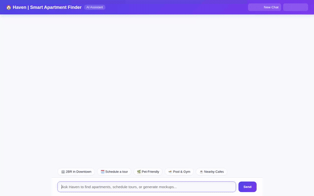

# Haven | Smart Apartment & Property Finder



Haven is an AI-powered apartment and property finder assistant built with the Google Agent Development Kit (ADK) and deployed on Agent Platform (Agent Runtime). Haven helps users discover, filter, inspect, and visualize apartment listings through interactive conversational search, structured A2UI display cards, real-time database persistence, long-term memory, and GenAI media generation.

---

## 🌟 What Haven Does

- **Smart Apartment Search & Filtering**: Searches real-time property catalogs in Google Cloud Firestore by neighborhood, price range, bedrooms, and pet policies.
- **Detailed Property Inspection**: Retrieves complete property specifications, pricing, square footage, amenities, and floor plans.
- **Property Listing Management**: Allows adding new property listings directly into Firestore.
- **Bookmarks & Tour Scheduling**: Bookmarks favorite properties and schedules tour appointments stored in Firestore.
- **Location & Amenities Lookup**: Converts addresses to latitude/longitude, inspects ZIP code demographic data, and finds nearby amenities (cafes, transit, parks, groceries).
- **Interior Design Mockup Generation**: Generates high-quality interior design photography using `gemini-3.1-flash-lite-image` in the `global` region, displaying artifacts inline and hosting them on Google Cloud Storage.
- **Property Video Tour Generation**: Generates 5-second video walk-throughs using `gemini-omni-flash-preview` in the `global` region, saving artifacts and uploading to public Cloud Storage.
- **Cross-Session Fact Memory**: Uses Vertex AI Memory Bank to remember user preferences, health needs, and pet/allergy details across sessions to tailor recommendations.
- **Structured A2UI Interface**: Emits A2UI v0.8 cards (Card, Column, Row, Text, Image) rendered natively in the chat web interface.

---

## 🛠️ Google Cloud Services & Technologies Wired Up

Based on the implemented codebase (`app/agent.py`, `app/a2ui_utils.py`, and `agents-cli-manifest.yaml`):

| Service / Technology | Purpose & Implementation |
| :--- | :--- |
| **Agent Development Kit (ADK)** | Core Python framework used to define tools, callbacks, and orchestration (`google.adk`). |
| **Agent Engine / Agent Runtime** | Deployed backend runtime handling A2A protocol requests and tool executions. |
| **Vertex AI Memory Bank** | Long-term memory service (`VertexAiMemoryBankService`) persisting facts and health/allergy constraints across sessions. |
| **Google Cloud Firestore** | NoSQL database storing apartment listings (`apartments`), user bookmarks (`user_bookmarks`), and scheduled tours (`tour_schedules`). |
| **Google Cloud Storage (GCS)** | Public media storage hosting generated interior mockup photos and video tour walk-throughs (`haven-apartments-media-qwiklabs-gcp-01-acd01b94c3ce`). |
| **Gemini 3.1 Flash Lite Image** | Vertex AI model (`gemini-3.1-flash-lite-image`) generating photorealistic interior mockups. |
| **Gemini Omni Flash Preview** | Vertex AI model (`gemini-omni-flash-preview` in `global` region) generating short property video tours. |
| **A2UI Protocol (v0.8)** | Agent-to-UI component rendering (`A2uiSchemaManager`, `BasicCatalog`) for structured cards. |
| **FastAPI Proxy & Web UI** | Modern web chat interface (`app/fast_api_app.py`) featuring Light/Dark mode, quick prompt chips, typing indicator, and copy-to-clipboard. |

---

## 🚀 Local Setup & Running Instructions

### Prerequisites
- Python 3.10+ with `uv` or `pip`
- `gcloud` CLI authenticated with GCP project access
- Environment variable `AGENT_ENGINE_RESOURCE_NAME` set to your deployed Reasoning Engine resource path.

### 1. Install Dependencies
```bash
uv sync
```

### 2. Run Local ADK Agent Playground
To launch the agent in the local ADK Web developer UI:
```bash
uv run adk web . --port 8000
```

### 3. Run Custom Web Chat Frontend
To launch the custom FastAPI proxy and web frontend locally:
```bash
AGENT_ENGINE_RESOURCE_NAME="projects/<PROJECT_ID>/locations/<LOCATION>/reasoningEngines/<ENGINE_ID>" \
AGENT_DIRECTORY="app" \
uv run python app/fast_api_app.py
```
Open your browser to the local server port printed by the FastAPI application.

---

## 📂 Project Structure

```
.
├── app/
│   ├── agent.py            # Main ADK Agent, tools, Memory Bank, & A2UI prompt setup
│   ├── a2ui_utils.py       # A2UI after_model_callback response transformer
│   └── fast_api_app.py     # FastAPI server proxy talking A2A protocol to Agent Engine
├── frontend/
│   └── static/
│       └── index.html      # Responsive web chat UI (Light/Dark mode, prompt chips, typing indicator)
├── agents-cli-manifest.yaml # Agent Platform deployment manifest
├── haven_demo.gif          # Demonstration recording
└── README.md               # Project documentation
```
